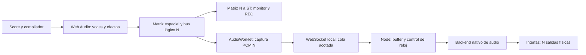

# syNo · espacio y salida multicanal

Fecha: 2026-11-26. Estado: diseño para discutir y ejecutar por etapas; no implementado.

Objetivo: interpretar una misma partitura en un sistema de N altavoces reales, conservar siempre una escucha estéreo y preparar una versión local ensayable para la próxima presentación en Suecia. No hay fecha ni equipamiento confirmados en este documento.

## 1. Alcance y decisiones

Requisitos del compositor: `p` multicanal; preview ST; altavoces con posiciones arbitrarias, sin depender de ambisonics; puente Node.js local; convivencia del espacio acústico con los mapeos de parámetros de FOLD; declaración de altavoces y posibilidad de ganancias discretas por salida.

Recomendación de diseño: separar tres cosas que pueden relacionarse, pero no son equivalentes:

1. **Partitura:** posición y trayectoria de cada fuente, o distribución explícita entre salidas lógicas.
2. **Sala:** posiciones de altavoces y transformación del espacio de la pieza a metros.
3. **Equipo:** interfaz, canales físicos, frecuencia de muestreo y calibración.

Cambiar de interfaz no debería exigir editar la pieza. Cambiar la sala puede modificar cómo se realiza su espacialización. Una mezcla explícita por altavoces requiere una disposición compatible o un remapeo deliberado.

Este plan recomienda escrituras, no las declara gramática aceptada. No incorporarlas todavía a ejemplos ejecutables, Help ni instrucciones de modelos.

## 2. Estado real y material reutilizable

En la aplicación actual, `p` es paneo estéreo y admite secuencias, rampas y azar. Las voces y los buses usan `StereoPannerNode`. El master, la grabación, la reverberación y los circuitos de feedback contienen supuestos estéreo. Hay que revisar el grafo completo: cambiar solamente el destino no produce espacialización N.

`o220` ya significa frecuencia de referencia de la afinación, y `o` es frecuencia en los destinos XYZ. `p[...]` ya tiene significado secuencial. Conservar ambos usos evita colisiones innecesarias.

Antecedente local: `obsidian-synomulti/src/main.ts` prueba canales mediante Web Audio; `main-process.js` ensaya dispositivos y salidas con Electron/naudiodon. Reutilizar ideas de enumeración y prueba individual, no asumir que es un puente operativo: el manifiesto inspeccionado no declara naudiodon y el código importa una forma de API que habrá que contrastar con la versión seleccionada. No modificar el plugin anterior.

Puntos de entrada del proyecto actual:

- `src/core/parser.ts` y `src/core/types.ts`: sintaxis y representación espacial compilada.
- `src/audio/engine.ts`, `src/audio/output-bus.ts`, `src/audio/feedback.ts`: voces, cadenas, master y circuitos.
- `src/core/visualization.ts`, `src/visuals/axis-labels.ts`, `src/components/Growth.svelte`: FOLD, coordenadas y etiquetas.

## 3. Notación propuesta: conservar p, distinguir sus dominios

Todas las formas nuevas de esta tabla son borradores. Espacios y comas siguen siendo separadores intercambiables; no volver a distinguirlos para resolver esta extensión.

| Escritura | Interpretación | Estado |
| --- | --- | --- |
| `p-1>1'10` | Paneo escalar de izquierda a derecha | Existe en estéreo |
| `p[-1 0 1]` | Secuencia de valores de paneo | Existe; conservar |
| `p[x 0.2 0 -0.4]` | Posición cartesiana XYZ | Propuesta: x marca una terna espacial |
| `p[o 0 0 9 0]` | Ganancias en cuatro salidas lógicas | Propuesta: o es una marca contextual dentro de p |
| `o220` | Referencia de afinación | Existe; conservar |

Prefiero `p[x ...]` por su brevedad; `p[xyz ...]` sería una variante más explícita a decidir. La marca es necesaria: tres números sin ella siguen siendo una secuencia, no una posición.

No usar `o1`, `o2` o `o?` como enrutamiento global: colisionan con la referencia de frecuencia. El modo por salidas puede vivir dentro de `p` sin añadir una segunda familia de comandos. Atajos para una sola salida, por ejemplo `p[o3]`, quedan abiertos; la primera etapa puede usar vectores completos y evitar otra ambigüedad.

### Coordenadas y movimiento

X = derecha; Y = arriba; Z = profundidad, con frente en Z negativo. Son ejes de espacio físico, independientes de los parámetros asociados a los ejes de FOLD.

La pieza usa coordenadas normalizadas, inicialmente −1…1; el perfil de sala define origen y escala hacia metros. Usar escala uniforme como primera opción y permitir una transformación explícita cuando la obra lo requiera. No limitar posiciones automáticamente al cambiar de sala.

Una transición vectorial podría escribirse así, **todavía no ejecutable**:

```text
s220v1'10p[x -1 0 -1]>[x 1 0 1]'10
```

Interpolar primero la posición, después calcular las ganancias. Las componentes usan el mismo reloj de la voz/bus. Alt-arrows, Glide y U deben conservar sus políticas actuales. Para N altavoces, el `p` escalar existente puede representar movimiento sobre X con Y/Z centrados; eso debe ser una política explícita del modo espacial, conservando el comportamiento estéreo cuando no hay disposición N.

### Ganancias directas

`p[o 0 0 9 0]` envía a la tercera salida lógica, usando 0…9 con 9 = ganancia unitaria. El número de componentes debe coincidir con el número de altavoces del perfil; un vector inválido produce diagnóstico, no truncamiento silencioso. Un vector cero es silencio.

No normalizar estas ganancias automáticamente: su suma es parte de la composición. `v` sigue controlando la intensidad/envolvente. Las rampas entre vectores son por componente. El modo XYZ, en cambio, sí normaliza su matriz de paneo.

Azar: conservar las reglas globales ya existentes para elecciones exactas e intervalos continuos. Una elección aleatoria de salida debe usar el PRNG de la partitura y una cadencia definida por ejecución/loop. Resolver la escritura compacta después de cerrar los tipos de p; no inventar otro significado para `?`.

## 4. Disposición: !spk / !speakers

Propuesta de alias largo/corto y array de filas `[id x y z]`, en metros:

```text
!spk[[1 -2 0 -2] [2 2 0 -2] [3 2 0 2] [4 -2 0 2]]
```

La identidad lógica permanece estable y empieza en 1. Los vectores de ganancias siguen el orden de las filas, no un orden implícito del driver; mostrar ese orden en el pod de salidas. Exigir IDs únicos y explicitar cualquier reordenación.

El perfil local, fuera del score, asigna cada ID a un canal físico. La API nativa puede contar desde cero: convertir en un solo límite y mostrar numeración humana coherente.

Mantener dos archivos posibles: layout portátil de la obra/sala y perfil local del dispositivo. El segundo incluye device ID, sample rate, buffer, mapa de canales, trims y retardos de calibración. No publicar identificadores personales del equipo dentro del suplemento anónimo.

La geometría permite calcular el paneo; no corrige por sí sola la acústica. Compensaciones de nivel/retardo necesitan mediciones y un punto de referencia elegido. Si se alinean tiempos, retrasar las llegadas tempranas hasta la más tardía; no simular retardos negativos ni aplicar aumentos de ganancia sin límites.

## 5. Primer algoritmo: DBAP

DBAP calcula ganancias desde las distancias entre fuente y altavoces y admite disposiciones arbitrarias. Es una referencia especialmente pertinente a la intuición del compositor sobre Lossius. Consultar la [versión revisada del artículo de Lossius, Baltazar y de la Hogue](https://jamoma.org/publications/attachments/icmc2009-dbap-rev1.pdf), que corrige ecuaciones de la edición inicial. Esto no atribuye a Lossius la autoría de un plugin concreto de REAPER.

Propuesta inicial: matriz continua de amplitudes con distancia regularizada y normalización de potencia. Para posición física q y altavoz sᵢ:

```text
rᵢ = sqrt(distance(q, sᵢ)² + blur²)
aᵢ = 1 / rᵢ^alpha
gᵢ = aᵢ / sqrt(sum(aⱼ²))
```

Es una formulación inicial a contrastar con la referencia y con escucha, no una copia completa de todos sus tratamientos. `blur > 0` evita singularidades; alpha = 1 corresponde aproximadamente a una caída de 6 dB por duplicación de distancia antes de normalizar. Empezar sin cambios bruscos de subconjuntos de altavoces.

La normalización conserva la suma de ganancias al cuadrado, no garantiza sonoridad perceptiva constante ni reconstrucción exacta del campo acústico. Escuchar trayectorias dentro y fuera del arreglo. VBAP puede ser un comparador posterior; ambisonics no es requisito de esta etapa.

## 6. Preview ST y salida N simultáneos

Derivar el monitor estéreo del mismo bus lógico N, antes de trims/retardos específicos de la interfaz. Una matriz N→2 toma las posiciones de altavoces para producir una referencia L/R, con nivel de monitor independiente. No pretende reproducir altura ni frente/atrás con precisión binaural.

El monitor sigue disponible aunque el puente esté desconectado. Para partituras sin disposición espacial, preservar el camino estéreo existente. El monitor y la sala tienen mute/volumen independientes, con estado visible; evitar enviar el monitor también a los mismos puertos físicos de la sala por accidente.

Grabación inicial: video con mezcla ST. Stems N o WAV multicanal pueden añadirse después, indicando si son previos o posteriores a calibración. No presentar el actual `MediaStreamDestination` estéreo como captura N.

## 7. Puente local: transportar audio real

Recomendación inicial: conservar la síntesis de syNo en Web Audio y transportar PCM multicanal al proceso local. Enviar solamente eventos/OSC obligaría a reconstruir FM, ruido, efectos, feedback y voces en otro motor para conservar el sonido actual.



Node no sustituye al driver: necesita un backend nativo. Probar primero [audify/RtAudio](https://github.com/almoghamdani/audify); comparar [naudiodon/PortAudio](https://github.com/Streampunk/naudiodon), presente en el antecedente local. Seleccionar y fijar versión únicamente después de verificar instalación, API y estabilidad en el equipo real. No instalar ambos por defecto ni declarar aptitud para concierto por su README.

El navegador puede exponer destinos de más de dos canales, pero su disponibilidad depende de la implementación/dispositivo; no convertirla en requisito universal del sitio. Ver [especificación Web Audio](https://www.w3.org/TR/webaudio/). La captura por Worklet deberá demostrar que conserva realmente los canales discretos antes del transporte.

### Arranque y transporte

- Para concierto, Node sirve el build local de syNo en loopback y abre WebSocket del mismo origen. La web pública conserva su versión autónoma ST. No depender de que HTTPS público pueda abrir un WS sin cifrar a localhost: intervienen permisos, contenido mixto y CSP.
- El servicio se limita a loopback y verifica origen/sesión. No abrir puertos de audio en el VPS. La infraestructura de IA puede seguir siendo opcional; el audio no viaja al servidor remoto.
- Negociar versión del protocolo, N, sample rate y layout antes de habilitar audio. Cabeceras: epoch de transporte, secuencia, índice de frame y tamaño. PCM Float32 con endianness y orden de canales definidos; adaptar/intercalar en el límite nativo.
- Separar control urgente y transporte PCM: Stop no debe quedar detrás de audio pendiente. Al cambiar de epoch, descartar paquetes viejos.
- Colas acotadas y métricas de ocupación, underruns, overflows, latencia y desconexión. No acumular segundos de audio para esconder un desajuste.
- El callback del dispositivo es nativo; no usar `setInterval` de JavaScript como reloj de la interfaz.
- El reloj del AudioContext y el de la interfaz pueden derivar incluso a igual sample rate nominal. Medir ocupación y resolver deriva con remuestreo adaptativo o una arquitectura de reloj compartido demostrada. No dar por resuelto el problema con un buffer grande.
- Desconexión: rampa breve a silencio, sin repetir indefinidamente el último bloque. Reconectar con nueva negociación y acción explícita de transporte.

Objetivo de primera prueba: 4 y luego 8 canales a 48 kHz, condicionado al hardware. A 8 canales Float32 son 1.536 MB/s de PCM, sin cabeceras; 16 canales duplican ese tráfico. El ancho de banda no valida por sí solo la latencia ni la estabilidad. La estructura admite N variable, con límites reales anunciados por el backend y por el grafo Web Audio.

## 8. Efectos, buses y master: trabajo indispensable

Un bus N no puede atravesar un procesador estéreo inadvertidamente. Revisar `channelCountMode` y `channelInterpretation`, con canales discretos y pruebas de aislamiento.

- Ganancia, filtros, chopper y delay deben conservar canales o declarar un cambio de topología.
- La reverb actual tiene respuestas estéreo: definir retornos espaciales explícitos o desarrollar una versión N; no prometer conservación espacial pasándola directamente por el convolver actual.
- El feedback cruzado de dos bandas sigue siendo un instrumento estéreo. Puede colocarse como un par de fuentes/retornos; no se convierte automáticamente en un circuito N.
- Propuesta para `{}p[x ...]`: colocar el bus reunido como un emisor común, declarando su reducción espacial en ese punto. Los buses sin reposicionamiento deben conservar las distribuciones de sus hijos. Anchura de una fuente estéreo y transformaciones espaciales de un conjunto quedan para una segunda etapa.
- El master actual incluye compresión y techo con supuestos estéreo. Diseñar protección N enlazada para evitar que ganancias independientes alteren la imagen; verificar también margen después de trims locales. Mostrar sobrecarga y no aceptar NaN/Infinity en el backend.

Las combinaciones todavía incompatibles deben producir un diagnóstico preciso; nunca convertirse silenciosamente en dos canales. La etapa de pruebas debe incluir cadenas ordenadas y anidadas, fuentes lyric/input y feedback, no únicamente osciladores simples.

## 9. FOLD: dos espacios que pueden convivir

Mantener identificadores de fuente compartidos, con datos separados:

- posición de crecimiento y transformación compositiva;
- valores de parámetros derivados de `@pov`, `@drf`, etc.;
- posición acústica y trayectoria espacial;
- cámara, zoom y desplazamiento exclusivamente visuales.

Primera interfaz sugerida: dos modos/pods hermanos, **Parameters** y **Speakers**, con opción de mostrarlos juntos. Speakers dibuja altavoces numerados, fuentes, trayectorias y contribuciones de ganancia. Un icono de cadena vincula crecimiento→posición espacial mediante una transformación explícita. Otro estado puede vincular solamente las cámaras; no confundirlos.

`@pov` conserva su significado actual. No convertir `@xyz` en un comando nuevo por esta conversación: XYZ describe los ejes, mientras los caracteres de @ son destinos de parámetros. Los offsets usados para separar visualmente un forest no deben alterar el audio salvo asignación compositiva deliberada. Mover el cubo para grabar tampoco mueve los sonidos.

Prioridad recomendada: posición espacial escrita explícitamente > vínculo espacial del growth > posición por defecto. Un p escalar derivado del growth puede gobernar X, pero no borrar Y/Z de una trayectoria vectorial. Afinar esta precedencia antes de implementar el compilador.

## 10. Implementación por etapas y criterios de salida

| Etapa | Entrega | Evidencia necesaria |
| --- | --- | --- |
| M0 · equipo | Ficha de OS, interfaz, driver, canales, sample rate, disposición y fecha | Enumerar y probar cada salida física del equipo previsto |
| M1 · puente | UI local, PCM discreto de 4→8 canales, monitor ST y panic | Señales distintas llegan a puertos distintos; sin mezclas implícitas; medir latencia, deriva y colas |
| M2 · notación | Tipos XYZ/ganancias, layout, DBAP, rampas y hash | Determinismo; compatibilidad de p secuencial/o; extremos y centro; ceros y layouts inválidos |
| M3 · grafos | Voces, buses/efectos compatibles, master N | Aislamiento, polifonía, sobrecarga, transiciones sin clicks y diagnóstico de casos pendientes |
| M4 · FOLD | Speakers + Parameters y vínculo explícito | Cámara independiente del sonido; trayectorias y ganancias coinciden con audio |
| M5 · ensayo | Build local fijado, perfil exportable y fallback ST | Ensayo de 45–60 minutos en la interfaz real, sin deriva creciente ni pérdidas no explicadas |

M1 puede generar señales de prueba sin sintaxis nueva: primero demostrar la salida real, después integrar el lenguaje. M2 y M3 deben estar completas para afirmar que una pieza espacial de syNo conserva sus cadenas y timbres. Una demo de canales no es todavía esa entrega.

El ensayo debe incluir Alt-arrows/Glide, cambios U, loops y secciones, forest denso, feedback, grabación, actividad de agentes, Stop, desconexión y recuperación. Registrar métricas junto al perfil del equipo. Preparar funcionamiento local sin red para lo que no requiera nuevas descargas/modelos.

La posición/ganancias explícitas y la transformación compositiva son semántica musical: incluirlas en los datos canónicos del score. Guardar layout y calibración con hashes separados, de modo que misma pieza/seed pueda compararse entre salas sin confundir eventos con realización física. Definir ambos niveles antes de afirmar equivalencia entre backends.

## 11. Decisiones todavía abiertas

1. Equipo y número de salidas para Suecia; geometría disponible, altura, subwoofers y fecha de ensayo. Un sub requiere política de bass management propia, no asumir que es otro altavoz de rango completo.
2. Marca `x` o `xyz` dentro de p y escritura definitiva de rampas vectoriales.
3. Semántica de paneo escalar en modo N y del posicionamiento de fuentes estéreo.
4. Atajo para seleccionar un output y selección aleatoria de outputs sin colisión con o.
5. Backend nativo y estrategia de deriva validados con el dispositivo.
6. Perfil de sala guardado en el proyecto frente a declaración inline, y comportamiento al importar una pieza sin su layout.

Primer paso operativo recomendado: M0/M1, con una señal diferente por salida y preview ST simultáneo. No depende de cerrar todos los atajos del lenguaje; sí determina si la arquitectura propuesta sirve para el concierto.

## Avance · primera prueba autorizada

El compositor autorizó el primer test después de este diseño. Hay una herramienta aislada en `tools/multichannel` y una página estática en `public/multichannel`: salida nativa de diagnóstico, retorno medido en BlackHole, preview ST separado y exportación WAV N desde el navegador. Ver [instrucciones, resultados y límites](multichannel-first-test.md). Es avance de M0/M1, no implementación de p espacial, DBAP ni streaming del motor actual. Se añade exportación offline multicanal de partituras como objetivo posterior al grafo N; WAV PCM como primera opción, ST y mapa de canales adjuntos.


## Avance · integración online

Se implementaron declaraciones expandidas/compactas !spk, envíos raw p[o1>2], matrices de ganancias, XYZ/DBAP, Speakers/overlay, seis ejemplos y render offline de partituras WAV N y copias ST WAV/OGG/MP3. La especificación vigente y sus límites están en [spatial-output.md](spatial-output.md). El puente nativo todavía es diagnóstico: conectar el grafo web en vivo sigue pendiente. No interpretar las propuestas históricas anteriores como restricciones que impidan los cambios ahora autorizados.
